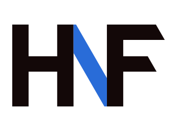
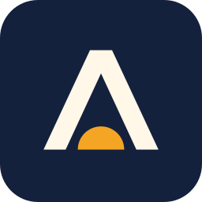
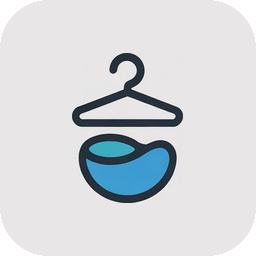
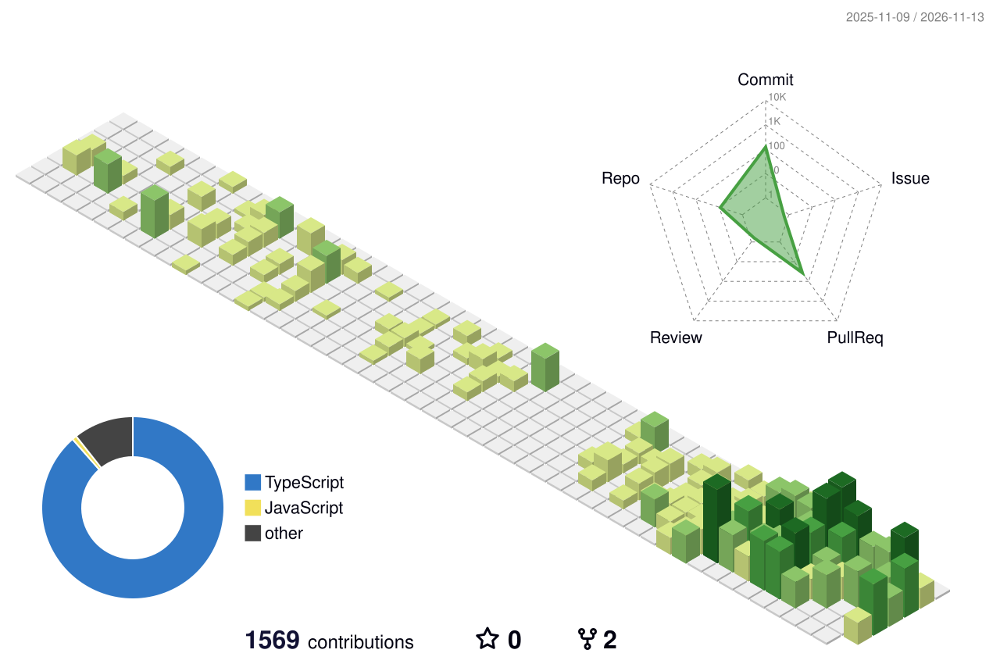

  <picture>
    <source media="(prefers-color-scheme: dark)" srcset="./assets/hnf-dark.svg">
    
  </picture>

<h1 align="center">Hey, I'm Hanif</h1>

  A fullstack developer from South Tangerang who likes building things end to end: 
  the part you click, the part that keeps your data, and all the quiet bits in between that stop it from breaking.

  
  
  
  

---

### What I'm up to

- Building web platforms for clients at **Notch**, a creative digital agency in Jakarta. The biggest one so far: rebuilding **UNICEF Indonesia's donation platform** with two other engineers. It went live in October 2026.
- Making side projects that fix my own problems, like a Telegram bot that keeps my spending in check.
- Always happy to hear about a good opportunity, whether it's remote, hybrid or on-site. Feel free to say hi.

### How I got here

I didn't start in tech. I studied Islamic Family Law, got curious about how the web actually works, and jumped into Purwadhika's fullstack bootcamp in 2025. I came out of it as Best Student of Batch 33, and I've been building ever since.

> *Start small, build it right, and let it grow.*

### Things I've built

<table>
  <tr>
    <td width="88" align="center"></td>
    <td>
      <b>Arunika</b> 
      My personal finance buddy on Telegram. I tell it what I spent, it writes it into Google Sheets. The AI is only allowed to draft; nothing is saved until it's signed and double-checked. 
      Python, SQLite, Telegram Bot API, Google Sheets API, MCP. Private repo, for now.
    </td>
  </tr>
  <tr>
    <td align="center"></td>
    <td>
      <b><a href="https://github.com/hanfauzi/coffe-bar">CoffeBar</a></b> 
      Everything a coffee shop needs behind the counter: a cashier, stock that gets used first in, first out, and a Gemini-powered advisor that tells you what to restock next. 
      React, Vite, NestJS, Prisma, PostgreSQL, Gemini API
    </td>
  </tr>
  <tr>
    <td align="center"></td>
    <td>
      <b><a href="https://laundr-project.vercel.app/">Laundr</a></b> 
      Laundry without leaving the house. Book a pickup, pay with Midtrans, and follow your clothes until they come back clean. 
      Next.js, Express.js, PostgreSQL, Prisma, Midtrans
    </td>
  </tr>
  <tr>
    <td align="center"></td>
    <td>
      <b>Tickly</b> (<a href="https://github.com/hanfauzi/mini-project-app">app</a>, <a href="https://github.com/hanfauzi/mini-project-api">api</a>) 
      Buy a ticket, get the email, show up. Organizers get their own dashboard to watch the sales come in. 
      Next.js, Express.js, PostgreSQL, Tailwind CSS
    </td>
  </tr>
</table>

### My toolbox

   
  

<!--
  STATS: hidden until GitHub Actions works again on this account (billing lock).
  To bring them back: delete this comment's first and last line, so the section below becomes visible.

### Some numbers

<picture>
  <source media="(prefers-color-scheme: dark)" srcset="./profile-3d-contrib/profile-night-rainbow.svg">
  
</picture>

  
<b>Achievements unlocked</b>

   
  

  
<b>When I usually code</b>

   
  

<picture>
  <source media="(prefers-color-scheme: dark)" srcset="https://raw.githubusercontent.com/hanfauzi/hanfauzi/output/github-snake-dark.svg">
  
</picture>
-->

  Thanks for stopping by.  
  

